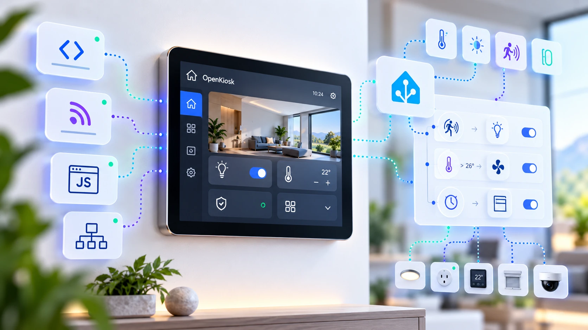

<p align="center">
  <picture>
    <source media="(prefers-color-scheme: dark)" srcset="icons/about-dark.webp">
    
  </picture>
</p>

# Open Kiosk

**A free, open-source kiosk browser for Android wall panels and smart-home dashboards.**

🌐 [open-kiosk.shoshins.com](https://open-kiosk.shoshins.com)

Open Kiosk turns an Android device into a single-purpose, always-on display for
Home Assistant or any web dashboard. No paid unlock, no cloud account, no
analytics, and no root.

> **Status: early development.** Everything marked ✅ below is implemented
> and unit-tested; validation on real hardware (KSK-010) is in progress.
> Feedback and contributions are very welcome.

---

## Why

Dedicated kiosk browsers are either paid, closed, phone-home to a vendor
cloud, or abandoned. Wall panels deserve better: they run unattended for
months, sit on your home network, and often show the controls to your front
door. Open Kiosk is built around two priorities:

- **Security first.** Locked to your dashboard's origin, no file access from
  web pages, remote APIs off by default, and no native bridge a page can abuse.
- **Performance first.** No heavy frameworks: plain Kotlin on the Android
  framework, so nearly all CPU and memory goes to rendering your dashboard.

## Features

| | Feature | Status |
|---|---|---|
| 🖥 | Fullscreen, immersive WebView with your start URL | ✅ |
| 🔒 | Navigation locked to the dashboard's origin | ✅ |
| ♻️ | Auto-recovery: network return, load retries with backoff, renderer crash rebuild | ✅ |
| ⚡ | Starts on boot (Android 8.1–9) or as the Home app | ✅ |
| 🔑 | PIN-protected settings with brute-force throttling | ✅ |
| ☀️ | Brightness and keep-awake | ✅ |
| 🌐 | Authenticated local [REST API](docs/api.md), off by default | ✅ |
| 📡 | [MQTT](docs/mqtt.md) with Home Assistant discovery | ✅ |
| 🧩 | Origin-checked [JavaScript bridge](docs/bridge.md), off by default | ✅ |
| 🌙 | Screensaver: clock, black, dim or URL, on idle or on command | ✅ |
| 👋 | Wake from Home Assistant motion sensors over MQTT or REST | ✅ |
| 🗣 | Text-to-speech | ✅ |
| 🚀 | Allowlisted app launcher | ✅ |
| 🟠 | F6 round secondary screen | ✅ |
| 📊 | Telemetry: memory, storage, network, battery, uptime | ✅ |
| 📷 | Presence from the device's own camera | 📋 |
| 🗂 | Self-hosted fleet manager and signed OTA updates | 📋 |

✅ implemented · 📋 planned. See the [full specification](docs/spec.md).

## Quick start

Requirements: Android 8.1 (API 27) or newer with Android System WebView.

**Download:** [latest signed APK](https://github.com/shoshins/open-kiosk/releases/latest/download/open-kiosk.apk)
([all releases](https://github.com/shoshins/open-kiosk/releases)), then
`adb install open-kiosk.apk`.

Or build it yourself:

```bash
git clone https://github.com/shoshins/open-kiosk.git
cd open-kiosk/android
./gradlew :app:assembleDebug
adb install app/build/outputs/apk/debug/app-debug.apk
```

Open **Open Kiosk** on the device, enter your dashboard URL (for example
`http://homeassistant.local:8123/`), and it takes over the screen. To start it
automatically, choose Open Kiosk when Android asks for the Home app.

**Settings:** tap the top-left corner five times within three seconds. The
first time, you choose a PIN; after that, the PIN is required.

## Security model

- **Origin lock.** Only the scheme, host and port of the start URL can load.
  Links elsewhere are ignored, and `file:`, `intent:` and `javascript:` URLs are
  refused.
- **No file or content access** from web pages, and no mixed content.
- **No privileged bridge by default.** The JavaScript bridge is opt-in,
  answers only the dashboard's origin, and exposes typed capabilities only:
  no shell, no arbitrary intents, no filesystem.
- **Settings behind a PIN**, stored as a salted PBKDF2 hash, with growing
  lockouts after wrong guesses. API tokens are stored only as hashes; the
  MQTT password is encrypted with an Android Keystore key.
- **Remote APIs are off by default**, token-authenticated with scopes, and
  bound to loopback unless you choose otherwise.
- **No telemetry leaves the device.** No analytics SDKs.
- Plain HTTP is allowed because most home dashboards serve it on the local
  network. Use HTTPS where you can.

Found a vulnerability? Please follow [SECURITY.md](SECURITY.md) rather than
opening a public issue.

## Performance principles

- Framework-only Android: no AndroidX, no Compose, no reflection-heavy
  libraries. Release builds are shrunk with R8.
- One WebView, created once and rebuilt only after a renderer crash.
- REST and MQTT are implemented directly on sockets: no HTTP or MQTT
  libraries, hard limits on every input.

Targets for the reference device are in [the spec](docs/spec.md#6-non-functional-requirements):
APK under 15 MB, cold start under 5 seconds, 72-hour unattended soak.

## Hardware support

Open Kiosk aims to run on any Android 8.1+ device. Vendor-specific hardware
gets **experimental** adapters, isolated from the core:

- **F6 wall panel** (Rockchip PX30, 1440×720, rotary knob with round secondary
  screen): in validation. Findings are in [docs/hardware/f6.md](docs/hardware/f6.md).
  Guide: [your own Home Assistant dashboards on the F6](docs/use-cases/f6-home-assistant.md).

Tested another panel? Please add it to the compatibility list with a pull request.

## Roadmap

| Release | Theme |
|---|---|
| v0.1 | Functional kiosk: fullscreen, boot, PIN, brightness, recovery |
| v0.2 | Connected kiosk: REST, MQTT, JavaScript bridge, TTS, app launcher |
| v0.3 | Smart kiosk: screensaver, presence, schedules |
| v0.4 | Managed kiosk: self-hosted manager, signed updates |
| v1.0 | Extensible platform: plugin interfaces, security audit, soak tests |

The detailed backlog is in [docs/spec.md](docs/spec.md#8-product-backlog).

## Repository layout

```text
android/   Android app (Kotlin)
docs/      Specification, hardware notes
site/      Project website (GitHub Pages)
.github/   CI, Pages deployment, issue templates
```

## Contributing

Pull requests are welcome. Start with [CONTRIBUTING.md](CONTRIBUTING.md), and
please follow the [Code of Conduct](CODE_OF_CONDUCT.md).

## License

[Apache License 2.0](LICENSE). Open Kiosk is an independent project and is not
affiliated with Fully Kiosk Browser, Home Assistant or any device vendor.
